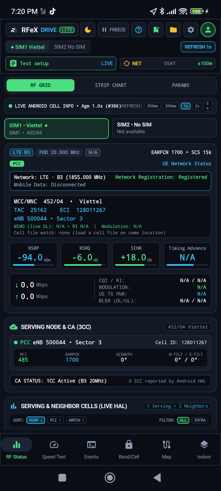
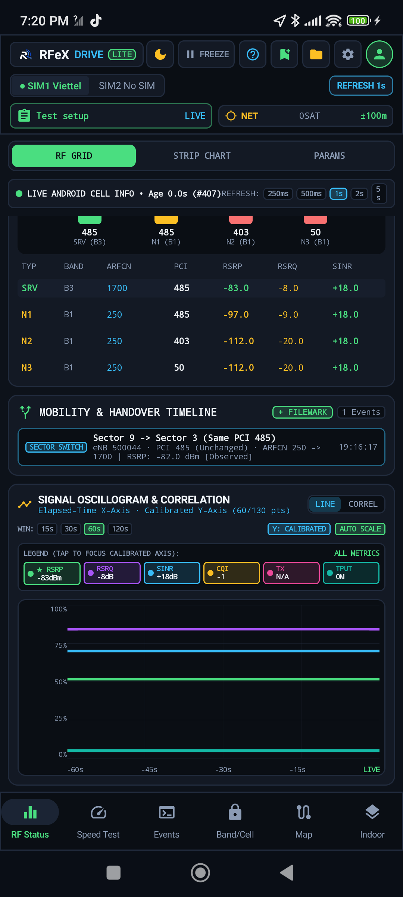
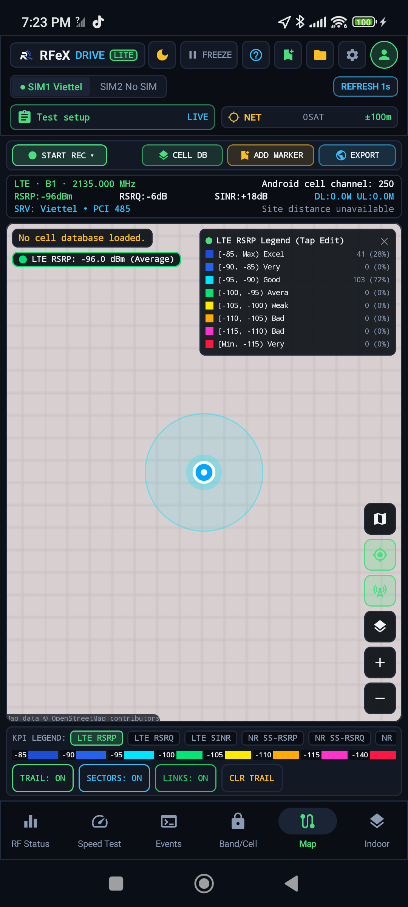
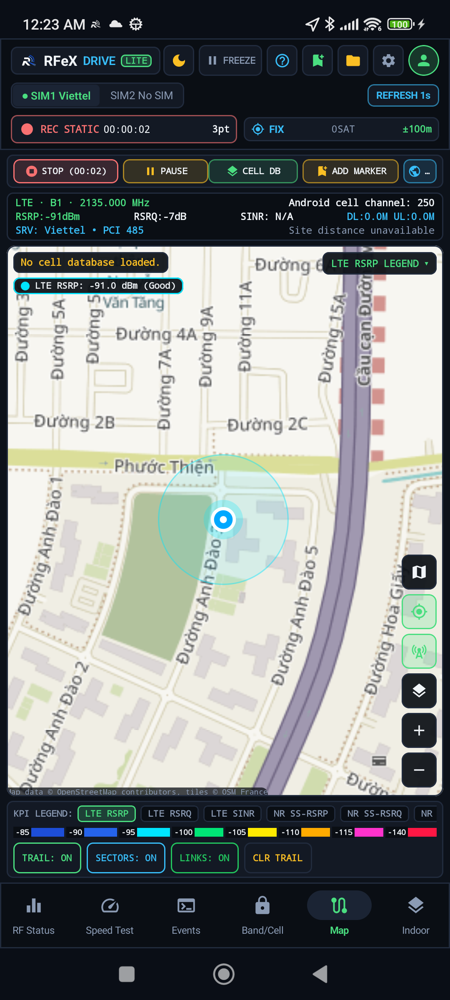
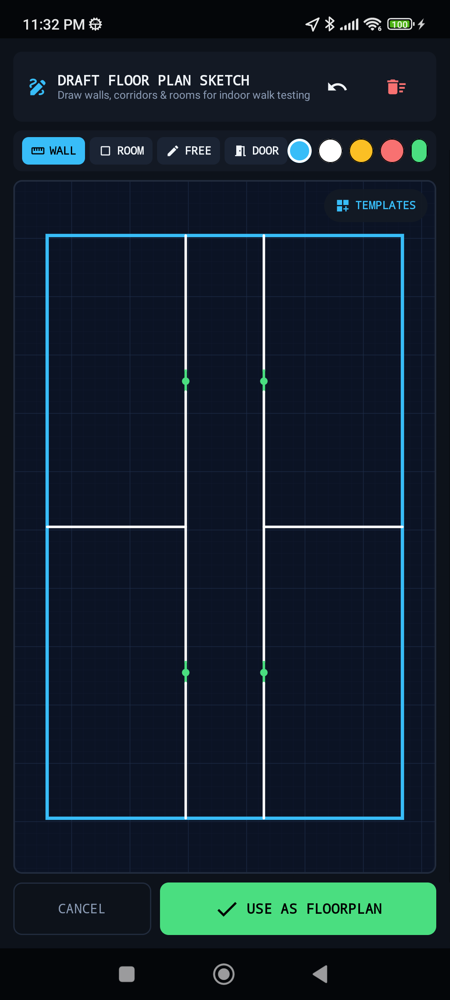
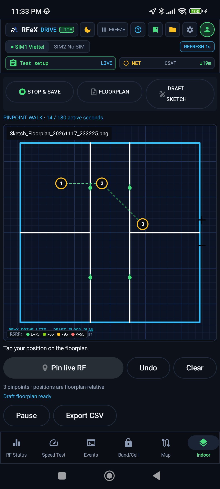
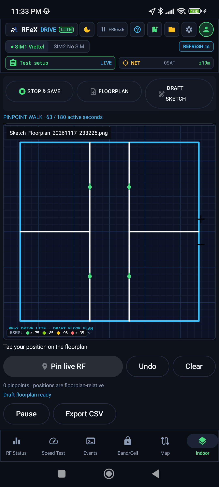

# RFeX Drive Lite v1.0.0

[-green.svg)](docs/SUPPORTED_DEVICES.md)

**Professional Cellular & RF Drive Test Engineering Application for Android**  
*Operating 100% via Documented Android SDK Public APIs — Zero Root, Zero Qualcomm DIAG*

---

## 📱 Product Overview

**RFeX Drive Lite** is an on-device radio frequency (RF) field test instrument engineered for telecom professionals, drive-test technicians, wireless optimization engineers, and cellular technology enthusiasts.

Built directly upon the production-tested UI and telemetry foundation of **RFeX Drive Build 98 QA**, Lite delivers real-time cellular diagnostics across **5G NR, 4G LTE, 3G WCDMA, and 2G GSM** networks without requiring root privileges, kernel patches, modem baseband hooks, or proprietary vendor daemons.

---

## 📸 Feature Showcase & Visual Preview

Explore the full verified gallery across all instruments in the **[Official Feature Gallery](docs/FEATURE_GALLERY.md)**.

### 1. Real-Time RF Telemetry & Cellular Instruments
Live radio parameters (RSRP, RSRQ, SINR, Timing Advance, PCI, EARFCN) and intra/inter-frequency neighbor cell tracking.

| Serving Cell Dashboard | Neighbor Cells List | 60-Second Oscillogram Strip Chart |
| :---: | :---: | :---: |
|  |  |  |
| *Real-time RSRP (-92 dBm), RSRQ (-5 dB), SINR (+15 dB)* | *Intra-frequency neighbor cells sorted by RSRP* | *Continuous 60s real-time waveform of RSRP* |

### 2. Engineering Basemaps, Cell Sites & Drive Testing
100% free, keyless basemaps (OpenStreetMap, Humanitarian OSM, Esri Satellite, OpenTopoMap) with 3GPP antenna azimuth wedges and spider links.

| Interactive Map & Basemaps | 3GPP Antenna Wedges & Spider Links | Drive Test Route Recording |
| :---: | :---: | :---: |
|  |  |  |
| *Vector tiles with live GPS puck and heading ring* | *150m antenna wedges & line-of-sight spider links* | *Color-coded RF trail with 5-minute logging cap* |

### 3. Indoor Floor Plan Sketch Studio & Walk Testing
Conduct indoor facility surveys without requiring CAD files using the built-in blueprint studio.

| Architectural Blueprint Studio | Indoor Pinpoint Walk Test | Clear & Reset Survey |
| :---: | :---: | :---: |
|  |  |  |
| *Navy blueprint grid with rooms, walls & templates* | *Geo-relative pins with on-canvas **Indoor RSRP Legend*** | *Safe reset dialog clears points while preserving plan* |

---

## ⚡ Key Verified Capabilities

- **100% Public Android SDK Telephony:** Operates strictly through `TelephonyManager`, `SubscriptionManager`, `ConnectivityManager`, and `LocationManager`.
- **Honest Hardware Provenance:** Metrics absent from the modem are cleanly reported as `N/A · not reported by modem (RRC Connected required)` rather than fabricated zeros.
- **Keyless Multi-Basemap Engine (Zoom 0–19):**
  - **OpenStreetMap Standard (Default):** Crisp worldwide street cartography complying with the OSM Tile Usage Policy.
  - **Humanitarian Roads (OSM France):** High-contrast road cartography.
  - **Esri World Imagery:** Top-down aerial satellite photography down to rooftop level.
  - **OpenTopoMap:** Topographic relief with elevation contours and rural roads.
  - **Offline Grid:** Blank coordinate canvas for offline or disconnected field surveys.
- **Cell Site Management:** Import CSV site databases up to 100 locations or use 1-tap `[ LOAD SAMPLE SITES (3 SITES) ]` to instantly populate local sectors and spider lines (`LINKS: ON`).
- **Indoor Blueprint Sketching:** Built-in drawing tools (`WALL`, `ROOM`, `FREE`, `DOOR`) and architectural presets (`Central Corridor & 4 Offices`, `Warehouse`, `Office Grid`).
- **Standard CSV Export:** Full session recording export via Android Storage Access Framework (SAF) for post-processing in desktop RF planning and GIS suites.
- **100% On-Device Privacy:** Zero tracking beacons, zero analytics SDKs, zero background data exfiltration, zero ads.

---

## 📋 Technical Specifications

| Parameter | Specification | Notes |
| :--- | :--- | :--- |
| **Package Name** | `com.rfex.drive.lite` | Production application ID |
| **Version** | `1.0.0` (Build `1`) | Initial production release |
| **Target SDK** | API 36 (Android 16 Ready) | Modern Android permission compliance |
| **Minimum SDK** | API 26 (Android 8.0 Oreo) | Broad device compatibility |
| **Footprint** | APK: 4.60 MB / AAB: 8.84 MB | Zero native `.so` binaries, pure Dalvik/ART dex |
| **Reference Hardware** | Xiaomi 13 Pro (`2210132G`) | Snapdragon 8 Gen 2 / Snapdragon X70 5G Modem |
| **Reference Network** | Viettel 4G LTE (`452/04`) | Band 1, EARFCN 250, PCI 485 |

---

## 📚 Official Product Documentation

- 📖 **[User Manual](docs/USER_MANUAL.md)** — Comprehensive operating guide and testing cadence.
- 📊 **[Technical Datasheet](docs/DATASHEET.md)** — Architectural specifications, parameters, and nominal ranges.
- 🖼️ **[Feature Gallery](docs/FEATURE_GALLERY.md)** — All 24 verified physical-device screenshots.
- 🎯 **[Feature Verification Matrix](docs/FEATURE_VERIFICATION_MATRIX.md)** — 27/27 feature implementation and acceptance ledger.
- 🔍 **[Troubleshooting Guide](docs/TROUBLESHOOTING.md)** — Diagnostic solutions for common modem and GPS quirks.
- ❓ **[Frequently Asked Questions (FAQ)](docs/FAQ.md)** — Common questions regarding Lite capabilities and pricing.
- 🗺️ **[CSV Site Database Format](docs/CSV_SITE_FORMAT.md)** — Site and antenna geometry file specifications.
- 📱 **[Supported Devices](docs/SUPPORTED_DEVICES.md)** — Tested hardware models and chipset compatibility.
- ⚠️ **[Known Limitations](docs/KNOWN_LIMITATIONS.md)** — Boundaries between Lite (Public API) and Advanced Pro (Root/DIAG).

---

## 🔒 Privacy, Licensing & Legal

- **First-Party License:** RFeX Drive Lite is **Proprietary Freeware** developed and owned by RFeX Technology. The first-party Android source code is proprietary and closed-source. See **[EULA](docs/legal/EULA.md)** and **[COPYRIGHT](COPYRIGHT.md)**.
- **Privacy Policy:** 100% On-Device execution with zero external data transmission. See **[PRIVACY_POLICY](docs/legal/PRIVACY_POLICY.md)**.
- **Data Safety Declaration:** Complete Google Play Data Safety declaration available in **[DATA_SAFETY](docs/release/DATA_SAFETY.md)**.
- **Third-Party Open Source:** Integrated open-source libraries (osmdroid, OpenSpeedTest, AndroidX) and geographic data (OpenStreetMap) retain their respective Apache-2.0, MIT, BSD, and ODbL licenses. See **[OPEN_SOURCE_LICENSES](docs/legal/OPEN_SOURCE_LICENSES.md)**, **[THIRD_PARTY_ATTRIBUTIONS](docs/legal/THIRD_PARTY_ATTRIBUTIONS.md)**, and **[THIRD_PARTY_NOTICES.txt](THIRD_PARTY_NOTICES.txt)**.
- **Security Policy:** Coordinated vulnerability disclosure guidelines detailed in **[SECURITY](SECURITY.md)**.

---

## 🧪 Test Evidence & Verification Package

Detailed physical-device verification reports and cryptographic audit records:
- **[Application Build Verification](docs/evidence/APPLICATION_BUILD_VERIFICATION.md)**
- **[Physical Device Test Results (31/31 PASS)](docs/evidence/PHYSICAL_DEVICE_TEST_RESULTS.md)**
- **[RF Metric Validation & Provenance](docs/evidence/RF_METRIC_VALIDATION.md)**
- **[Recording & Export Validation](docs/evidence/RECORDING_EXPORT_VALIDATION.md)**
- **[UI & Layout Regression Results](docs/evidence/UI_REGRESSION_RESULTS.md)**
- **[Automated Unit Tests Summary (31/31 PASS)](docs/evidence/AUTOMATED_TEST_SUMMARY.md)**
- **[Release Artifact Verification & Signatures](docs/evidence/RELEASE_ARTIFACT_VERIFICATION.md)**
- **[Historical Defect Closure Summary](docs/evidence/DEFECT_CLOSURE_SUMMARY.md)**
- **[Evidence Index & Checksums](docs/evidence/EVIDENCE_INDEX.md)**

---

## 🌐 Ecosystem & Support

- **Official Product Portal:** [https://rfex.app](https://rfex.app)
- **Enterprise Cloud Platform:** [https://rfex.cloud](https://rfex.cloud)
- **Public Ecosystem:** [https://rfex.one](https://rfex.one)
- **Technical Support:** `support@rfex.app`
