# RFeX Drive Lite v1.0.0 — Official Feature Gallery

**Product:** RFeX Drive Lite  
**Package:** `com.rfex.drive.lite`  
**Version:** 1.0.0 (Build 1)  
**Hardware Reference:** Xiaomi 13 Pro (`2210132G`, Snapdragon 8 Gen 2, Android 13)

This gallery showcases all 24 verified physical-device screenshots captured on release hardware.

---

## 1. First-Launch Permission Onboarding Wizard

Transparent, user-centric 5-step onboarding flow explaining Android runtime permissions prior to system prompts.

| Step 1: Welcome & Architecture | Step 2: Precise Location Access |
| :---: | :---: |
| 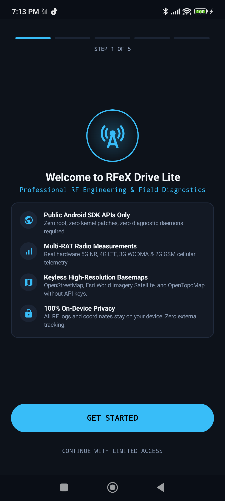 | 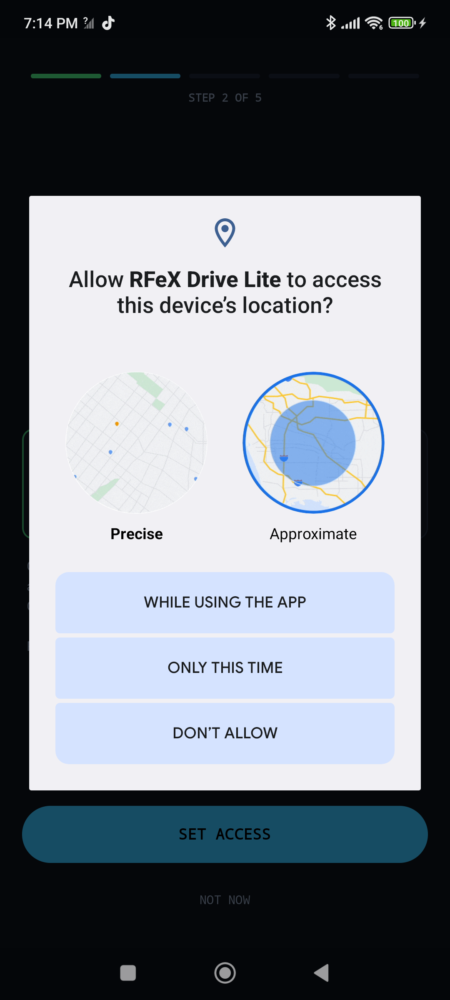 |
| *Overview of 100% public Android SDK API execution.* | *Transparent disclosure for GPS drive-test route tracking.* |

| Step 3: Phone & SIM State | Step 4: Foreground Notifications |
| :---: | :---: |
| 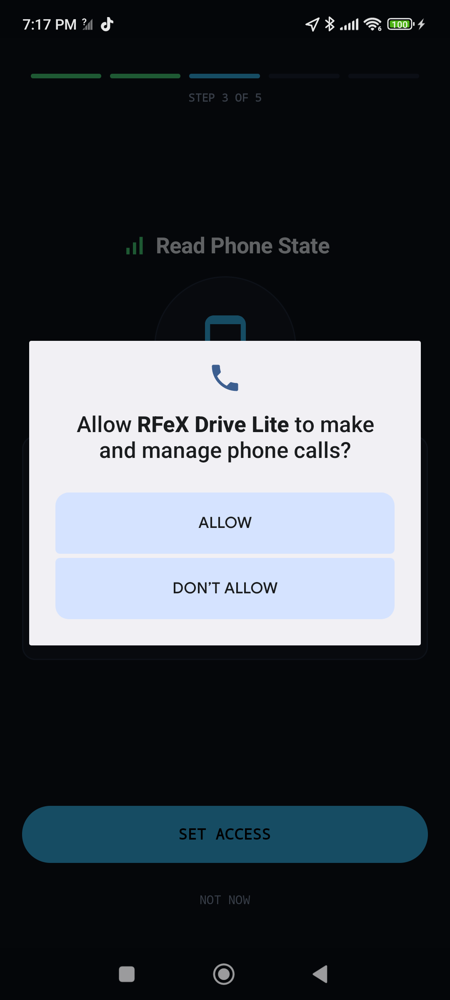 | 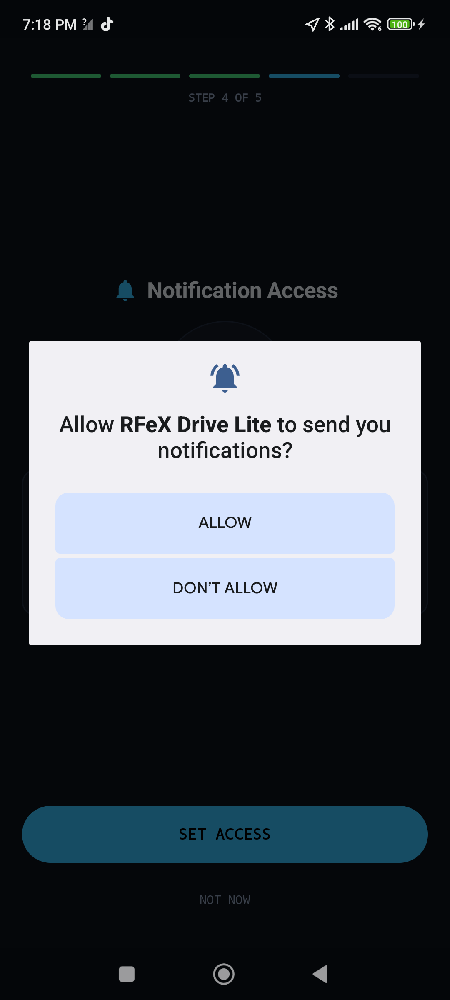 |
| *Reassuring notice: never manages or monitors calls.* | *Enables persistent background drive-test recording.* |

---

## 2. Real-Time RF Telemetry & Cellular Instruments

Live cellular RF metrics captured directly from the Android Radio Interface Layer over Viettel 4G LTE.

| Serving Cell Dashboard | Hardware Telemetry & Radio Version |
| :---: | :---: |
| 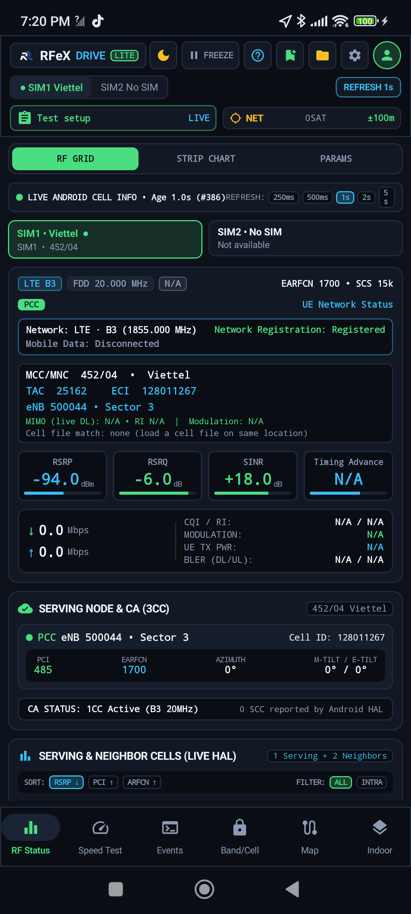 |  |
| *Live RSRP (-92 dBm), RSRQ (-5 dB), SINR (+15 dB), PCI 485.* | *Clean, deduplicated Qualcomm baseband version (`MPSS.DE...`).* |

| Serving & Neighbor Cell List | RF Oscillogram Strip Chart |
| :---: | :---: |
| 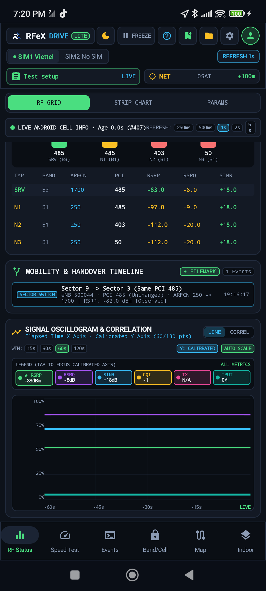 |  |
| *Live intra-frequency neighbor cells sorted by RSRP.* | *60-second real-time scrolling oscillogram of RSRP.* |

| RF Correlation Scatter Plot | Hardware Parameters Diagnostic Tab |
| :---: | :---: |
|  | 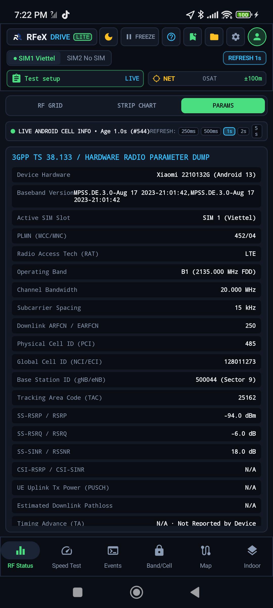 |
| *Stationary condition fix: points rendered cleanly with r=0.00.* | *Dynamic host OS detection (`Xiaomi 2210132G Android 13`).* |

---

## 3. Engineering Basemaps, Cell Sites & Drive Testing

Interactive mapping with policy-compliant keyless basemaps and 3GPP antenna azimuth visualization.

| Interactive Live Map | Color-Coded RF Measurement Route |
| :---: | :---: |
| 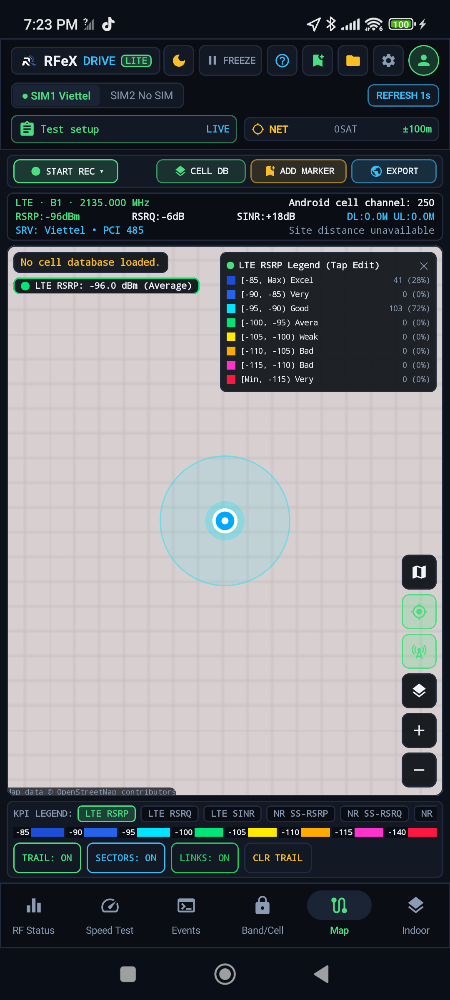 |  |
| *OpenStreetMap Standard vector basemap with live GPS puck.* | *Live drive-test breadcrumbs color-coded by RSRP threshold.* |

| Keyless Multi-Basemap Selection | 1-Tap Sample Sites & Spider Links |
| :---: | :---: |
| 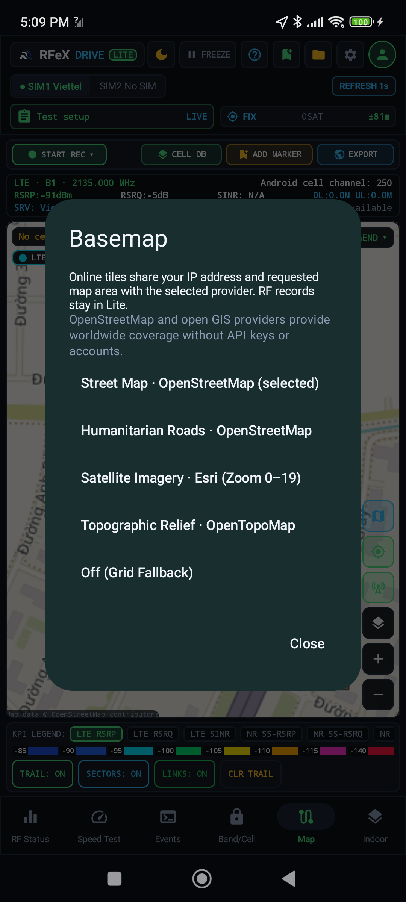 |  |
| *OpenStreetMap, Humanitarian, Esri Satellite, OpenTopoMap.* | *3GPP sector azimuth wedges and spider links (`LINKS: ON`).* |

| Drive Test Active Recording | Horizontal Saved Sessions Manager |
| :---: | :---: |
| 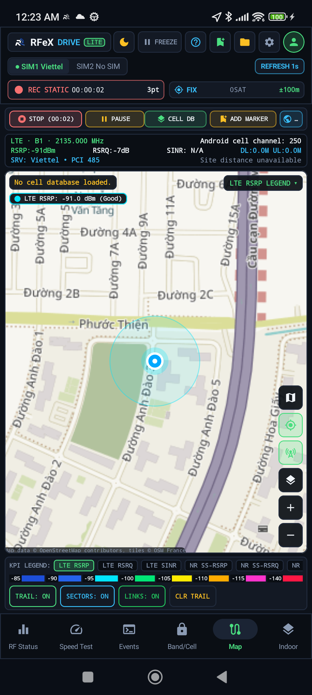 | 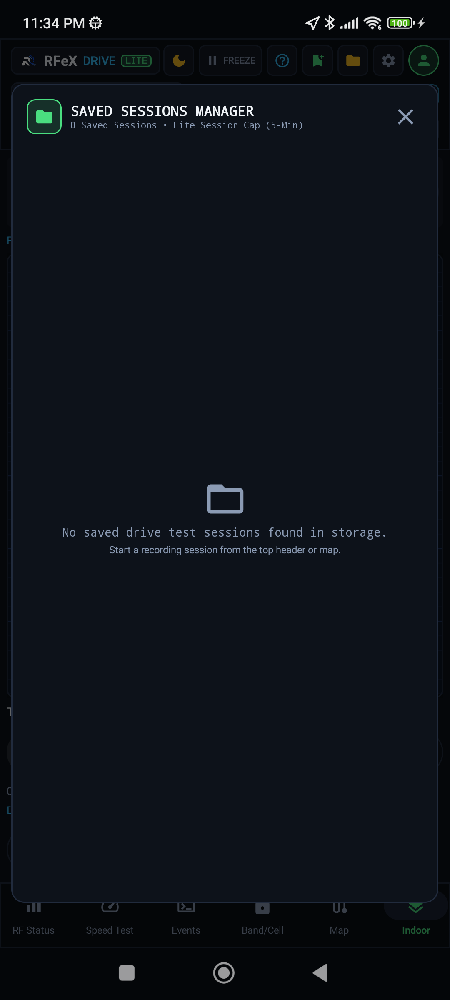 |
| *Synchronized GPS & RF recording with live sample counter.* | *Fixed horizontal badge layout (`20 pts • 1.0 KB`).* |

| Android SAF CSV Export | Sector Azimuth Preview |
| :---: | :---: |
| 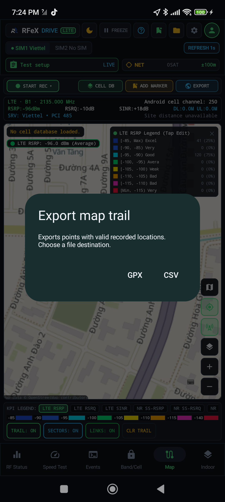 |  |
| *Native Storage Access Framework export dialog.* | *150m illustrative beamwidth & line-of-sight tracking.* |

---

## 4. Indoor Floor Plan Sketch Studio & Walk Testing

Conduct indoor wireless surveys without needing CAD or external floor plan files.

| Architectural Blueprint Studio | Live Pinpoint Walk Test & Canvas Legend |
| :---: | :---: |
| 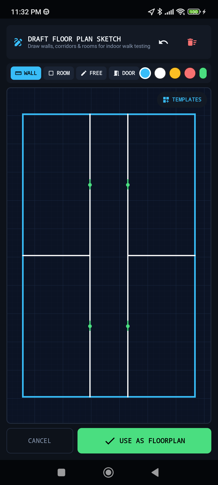 | 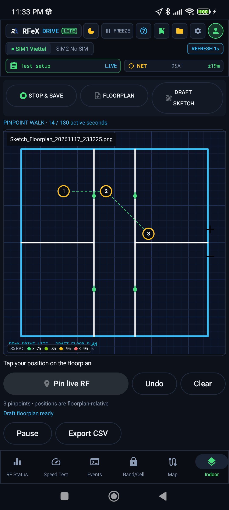 |
| *Draft sketch studio with clean ASCII title block.* | *Pinpoint walk test with on-canvas **Indoor RSRP Legend**.* |

| Indoor Survey Clear & Reset | Comprehensive Offline Help Center |
| :---: | :---: |
| 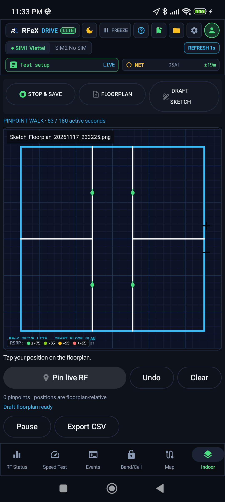 | 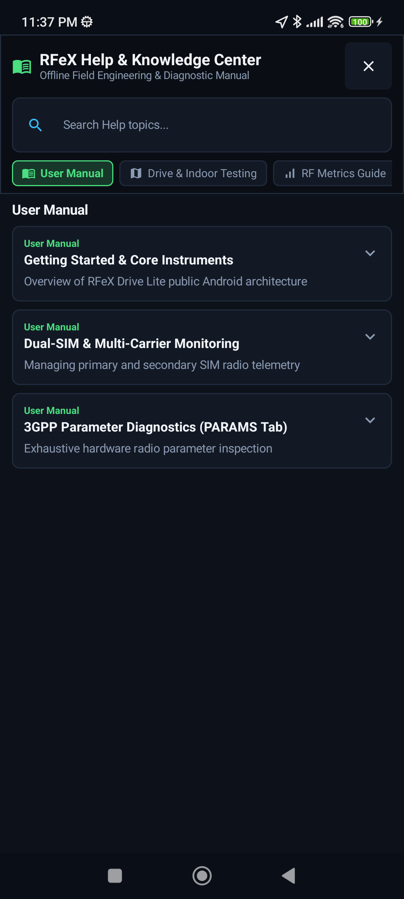 |
| *Clear confirmation dialog resets points while saving plan.* | *8 offline categories: manual, metrics, troubleshooting.* |

| 100% On-Device Privacy Guarantee | Third-Party Open Source Notices |
| :---: | :---: |
| 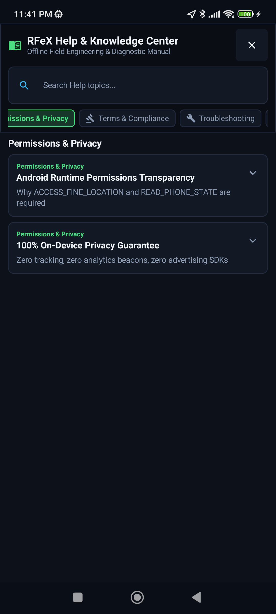 | 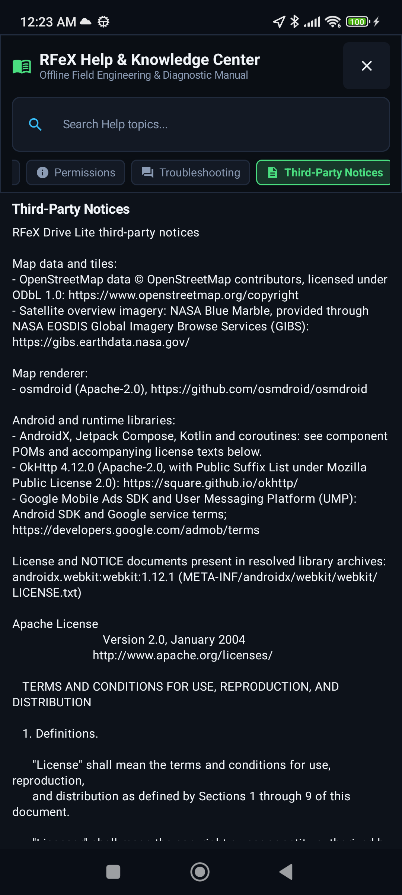 |
| *Transparent guarantee: zero tracking, zero ads.* | *Embedded Apache-2.0, MIT, BSD, and ODbL legal texts.* |
